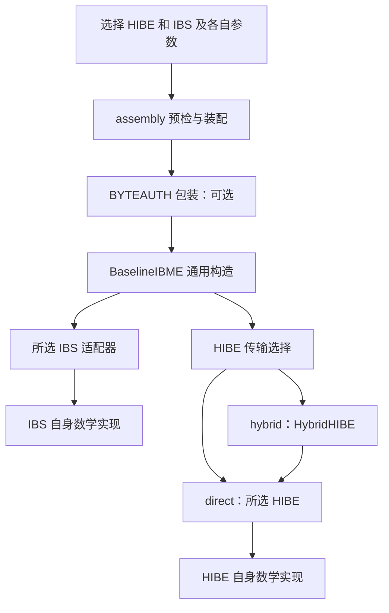

# 给其他队员的复用说明：通用构造、公共框架与算法专属适配

本文面向独立实现其他 HIBE、IBS 的队员，回答：**CHKP + Luo 这套代码，哪些可以直接用，哪些只能参考，哪些必须按新论文重新实现？**

初版核对基线：2026-10-12 的集成提交 `19560c4`；本次源码复核：2026-10-18 的上游 `4472775`。公共六/五方法及本文的 Baseline、Hybrid、BYTEAUTH 调用顺序继续适用，新增示例说明后续模块怎样复用。当前完成程度仍以 [PROJECT_STATUS](PROJECT_STATUS.md) 为准，接口与验收要求以 [IMPLEMENTATION_SPEC](../IMPLEMENTATION_SPEC.md) 为准。本文是阅读和交接指南，不另设一套规范。

## 1. 先读这一页

可以复用现有框架。其他队员不需要再写一套 IB-ME 协议、命令行、组合配置和字节认证包装。

但“通用框架已经存在”与“某个算法已经实现”是两项工作。例如，把新 HIBE 的方法命名为 `derive`，并不会自动得到它的陷门委派、采样分布或正确参数；这些仍由算法实现者完成。

### 按我们现在的顺序推进

1. **第一阶段：独立实现算法目录中的各个原语。** 每个算法按自己的论文实现、测试、记录条件，可以先使用原生接口或 C/C++/Sage 程序。交付可执行的研究参数和单体测试；不要求这一阶段全部接入统一 CLI。
2. **第二阶段：挑选、适配和组成完整方案。** 对可用实现补适配器，注册 HIBE/IBS，检查组合容量、状态和安全前提，再做正式参数选择与组合验收。
3. **跨阶段保留来源记录。** 第一阶段就记录算法版本、公式、参数含义、随机数及失败语义，第二阶段才能准确适配。示例参数可以先跑；不能到最后才确认实现的究竟是哪一个算法。

这两个阶段按**每个原语的就绪程度**衔接：一个模块完成即可接入适配和相应配对，其他人继续独立实现，不必等目录里全部算法同时完成。最终选择三个报告重点，也不限制就绪池中的实现和可行组合数量。

这里的“算法目录”指[现行算法总表](ALGORITHM_CATALOG.md)中的项目条目。候选、论文变体、研究原型、已注册后端分别记录；本文不把它们都改写成已实现算法，也不重新指定最终三套组合。

### 四种东西不要混在一起

| 层次 | 用通俗话说 | 本仓库对应 | 换算法时怎么处理 |
|---|---|---|---|
| 通用密码构造 | 怎样把 HIBE 和 IBS 组合成 IB-ME | `BaselineIBME` | 继续共用，保持身份顺序和签名消息语义 |
| 公共工程框架 | 怎样选择模块、传数据、保存状态、运行测试 | assembly、Hybrid、BYTEAUTH、CLI | 满足各自条件后复用 |
| 算法适配 | 把该算法自己的对象和功能接到框架 | 后端方法、解码器、注册项、容量/绑定检查 | 每个新算法分别补齐 |
| 算法数学实现 | 真正生成密钥、采样、委派、签名、解密 | CHKP 格工具、Luo 模格运算等 | 依新论文实现；不能只改类名或参数 |

**“完整实现”在这里指研究代码的功能链条已经接通。** CHKP + Luo 当前记录仍为 `security_claim=none`、`backend_admitted=false`、`parameters_are_formal=false`。尤其当前 CHKP 小参数存在公开攻击。具体证据见[统一交付](deliveries/2026-10-12-chkp-luo/README.md)，不能据此把其他组合也标为安全或已验收。

## 2. 从外到内看代码



图表示调用层次。HIBE 与 IBS 是并列原语；BYTEAUTH、Hybrid 是工程包装，不能合并标作王老师原始构造的全部内容。CLI 状态事务与测试驱动在这些模块外协调调用。

| 读什么 | 入口 | 主要责任 |
|---|---|---|
| 通用 IB-ME 五算法 | [baseline.py](../src/ibme/protocol/baseline.py) | `BaselineIBME` 的 Setup、SKGen、RKGen、Enc、Dec |
| HIBE 公共接口 | [hibe/api.py](../src/ibme/hibe/api.py) | 六个基本方法及额外密钥绑定能力 |
| IBS 公共接口 | [ibs/api.py](../src/ibme/ibs/api.py) | 五个基本方法、对象与失败约定 |
| 编码基础 | [core/encoding.py](../src/ibme/core/encoding.py) | 长度前缀、域分隔和规范解析 |
| 大载荷包装 | [hybrid_hibe.py](../src/ibme/protocol/hybrid_hibe.py) | HIBE 保护种子，AEAD 保护完整协议载荷 |
| 字节完整性包装 | [byteauth.py](../src/ibme/protocol/byteauth.py) | OTS、内部承诺、完整密文字节绑定 |
| 组合配置与运行时 | [assembly/__init__.py](../src/ibme/assembly/__init__.py) | `SuiteConfig`、`make_suite`、`validate_suite`、`build_runtime` |
| 原语登记 | [assembly/registry.py](../src/ibme/assembly/registry.py) | `BackendSpec`、`BackendRegistry` 及各算法登记项 |
| 算法路线与 CI 计划 | [assembly/catalog.py](../src/ibme/assembly/catalog.py)、[ci/suites.json](../ci/suites.json) | 文献路线、后端标识及分层测试任务，不代替可执行后端 |
| CLI 与状态事务 | [cli.py](../src/ibme/cli.py)、[cli_state.py](../src/ibme/cli_state.py) | 对象恢复、加锁、保存、命令入口 |

同一个文件也可能有两种责任。例如注册表的框架是通用的，而其中 `_chkp_configuration`、`_luo_check` 等函数是算法专属检查。不能按“文件放在公共目录里”判断所有内容都能原样套用。

## 3. 王老师的通用构造到底复用了什么

用 Alice 给 Bob 发消息说明。记发送身份为 `phi`，目标接收身份为 `rcv`；解密者声明要接受的发送身份为 `snd`，其自身身份为 `rho`。

### 3.1 Setup 和发钥

1. `BaselineIBME.setup` 分别调用 HIBE 和 IBS 的 Setup，保存组合公钥与主密钥。
2. `skgen(msk, Alice)` 调用 IBS 的 `key_extract`，得到 Alice 的签名密钥。
3. `rkgen(msk, Bob)` 调用 HIBE 的 `extract`，得到 Bob 的第一层接收密钥。

HIBE 参数与 IBS 参数分别传入。它们不要求使用相同的 `q`、维度、环或困难假设。历史 Python 调用有省略 `ibs_params` 的兼容路径；新组合应显式传两边参数，不能据此假定两种参数可互换。

### 3.2 Baseline 加密

代码的核心关系是：

```text
signed_message = encode_message(rcv, message)
signature      = IBS.sign(sender_key, signed_message)
payload        = encode_signature(signature) || encode_bytes(message)
ciphertext     = HIBE.encrypt(hpk, rcv, phi, payload)
```

`||` 表示拼接；实际使用规范编码。签名对象通过自己的编码输出字节，协议不读取它的格向量、challenge 或 Hint。HIBE 的身份顺序一直是 **第一层接收者，第二层发送者**。

### 3.3 Baseline 解密

1. 用接收者第一层密钥和声明的发送身份 `snd`，调用 HIBE 的 `derive`。
2. 用第二层密钥调用 HIBE 的 `decrypt`；失败返回 `BOTTOM`。
3. 严格解析恢复出的签名字节和消息，交给所选 IBS 的 `load_signature`。
4. 验证 `IBS.verify(ipk, snd, encode_message(rho, message), signature)`。
5. 验证通过返回消息，否则返回 `BOTTOM`。

预期匹配条件是 `rho == rcv` 且 `snd == phi`。新原语通过公开接口提供同样的功能，通用构造就无需复制一份。

**安全适配另有前提。** 能完成这些调用，只说明功能接口可接通；匿名性、身份安全模型、IBS 固定身份密钥的重复使用条件及组合所需的不可伪造性，仍须对照论文与当前服务方式核验。本文不新增安全归约，也不把 Python 接口通过视作定理前提成立。

## 4. 可以直接复用的两个包装

### 4.1 Hybrid：让 HIBE 只保护小种子

在 direct 模式中，HIBE 要承载完整的“签名 + 消息 + 编码”。签名很大时，这会超过底层 HIBE 的消息容量。

现有 `HybridHIBE` 的流程是：生成 32 B 随机种子 → 用 HIBE 加密种子 → 用 HKDF 从种子导出密钥 → 用 AES-GCM 加密完整协议载荷。解密先恢复种子，再验证并解密 AEAD 载荷。

可以复用整个包装，但新 HIBE 必须提供以下能力：

| 条件 | 新算法要回答的问题 |
|---|---|
| 明文容量 | 能否无损加密、恢复 32 B 种子？是否需要算法特定编码？ |
| 身份容量 | 能否接受包装后的两层身份？原始身份上限 64 B 时，目前编码为 86 B |
| 委派 | 是否真实支持从第一层接收密钥产生第二层发送身份密钥？ |
| 对象恢复 | 公钥、私钥、密文能否按完整参数与上下文严格恢复？ |
| 密钥绑定 | 能否验证私钥属于这个公钥与身份路径，而非只比较任意标签？ |
| 安全对应 | 原算法及所选参数是否满足该组合需要的隐私等条件？ |

Hybrid 将完整 HIBE capsule 纳入 AAD，并绑定相关上下文、nonce 和长度。因此“改动 capsule 后仍解出相同种子”不能据此跳过 AEAD 检查。这个工程性质也不能补救已可被公开恢复的种子。

**32 B 是当前包装规格；256 个目标是 CHKP 逐比特实现对它的展开。** 其他 HIBE 可能用不同的明文空间和打包方式，不必照抄 CHKP 的 256 次原像采样。

### 4.2 BYTEAUTH：保护实际传输字节

BYTEAUTH 是现有协议外的额外包装，默认 CLI 使用它。它生成一次性 Lamport 签名密钥，把该公钥的承诺放入内部消息，再对外层完整密文字节签名。

其加密顺序是：

```text
原消息 + OTS 公钥承诺
  → 内部 envelope
  → Baseline：IBS 签名接收者身份和 envelope
  → HIBE / Hybrid 加密
  → OTS 签名外层 body（上下文、OTS 公钥、内部密文字节）
```

其解密顺序必须按实际代码理解：

1. 严格解析外层，核对组合公钥上下文，验证外层 OTS。
2. 读取内部密文，进入 Baseline：HIBE 委派和解密；若选择 Hybrid，则恢复种子后验证 AES-GCM。
3. 解析内部 IBS 签名与 envelope，验证发送身份对应的 IBS 签名。
4. 读取 envelope，比较内部 OTS 承诺和外层 OTS 公钥的承诺。
5. 全部通过才返回原消息。

所以外层 OTS 验证在解密前，发送者 IBS 验证在恢复载荷后。二者责任不同，缺少任何一项都不能算当前 BYTEAUTH 流程完成。Hybrid wire 本身也没有一个独立的 IBS 签名字段：IBS 签名位于其加密的协议载荷内。

新组合可以共用此代码，不应再复制一套“某算法版 BYTEAUTH”。它不自动赋予任意底层原语 CCA、QROM 或正式安全等级。

## 5. 新原语最终需要适配哪些接口

下面是第二阶段的接入清单。第一阶段的原生实现只需保留清楚的对应关系，不强制立即改成这些 Python 方法。

### 5.1 HIBE：六个基础方法

| 方法 | 必须提供的语义 |
|---|---|
| `setup(params, *, rng=None)` | 按本算法参数生成公钥、主密钥 |
| `extract(master_secret, parent_id, *, rng=None)` | 产生接收身份的第一层私钥 |
| `derive(level1_key, child_id, *, rng=None)` | 从第一层私钥委派到指定第二层身份 |
| `encrypt(pk, parent_id, child_id, payload, *, rng=None)` | 对两层身份加密载荷 |
| `decrypt(level2_key, ciphertext, *, rng=None)` | 返回载荷字节，正常解密失败返回 `None` |
| `load_ciphertext(data)` | 严格读取本算法规范密文格式 |

还需提供公钥、主密钥、第一层私钥、第二层私钥的规范对象编码与解码。第一层对象公开 `identity`，第二层对象公开 `parent_identity`、`child_identity` 等契约元数据；协议无需读取内部矩阵。

`validate_key_binding(public_key, secret_key)` 是独立的 `HIBEKeyBindingValidator` 能力，**不是第七个基础 HIBE 方法**。基础协议接口将它与六方法分开；Hybrid 要求后端提供或显式注入该校验器。它只读、不消耗随机性，只有返回字面 `True` 才接受。校验内容依算法而定，并不证明私钥来自正确的采样分布。

公开密文不能为方便校验而新增可公开枚举的明文身份或身份摘要，破坏预期匿名性。需要绑定的私钥路径、公开上下文和完整参数应按对应对象契约保存。

### 5.2 IBS：五个基础方法

| 方法 | 必须提供的语义 |
|---|---|
| `setup(params)` | 生成 IBS 公钥、主密钥 |
| `key_extract(master_secret, identity)` | 提取该发送身份的签名密钥 |
| `sign(signing_key, message)` | 对完整编码消息签名 |
| `verify(public_key, identity, message, signature)` | 返回验签布尔值 |
| `load_signature(public_key, data)` | 按公钥参数严格读取签名 |

IBS 当前通过后端构造时的 `rng=...` 注入随机源，和 HIBE 方法中的 `rng` 关键字不同。不能为“看起来统一”而悄悄改公共调用约定。

签名密钥已经绑定身份，`sign` 不再额外接收一个可能不一致的身份参数。装配层使用 `BackendSpec.master_public_key` 从主对象取得公开上下文；不要假设每种 IBS 主密钥都天生有 `.public_key` 字段。

规范数据错误应按契约拒绝；采样中止、资源不足、状态故障必须保留原因。不能返回伪造的默认签名，也不能把程序配置错误全部吞成“验签失败”。

### 5.3 适配器不是只转发方法名

通常需要处理五项差异：参数类型、对象类型、身份编码、错误语义、序列化/状态。如果原生 C 实现用整数错误码，适配器要明确映射；如果其私钥对象依赖外部公钥或采样缓存，恢复对象时也要恢复这些依赖。

数学算法不必为了公共接口而改成另一种算法。不同算法可以保留不同的数据结构、模数和运算库；通过明确的公开对象及字节接口接到框架。

## 6. CHKP 这一套里，哪些是专属工作

| 部分 | 代码入口 | 是否可直接套给其他 HIBE |
|---|---|---|
| 对外六方法及调用顺序 | [chkp/backend.py](../src/ibme/hibe/chkp/backend.py) 中的 `CHKPHIBE` | 可参考组织方式；内部调用按新算法替换 |
| 参数与容量 | [chkp/params.py](../src/ibme/hibe/chkp/params.py) | 字段与约束专属，不能只改算法名称 |
| 密钥、密文及上下文恢复 | [chkp/objects.py](../src/ibme/hibe/chkp/objects.py) | 可借鉴严格解析思路；维度、方程、格式需重写 |
| 真正的陷门/委派/采样 | [lattice/chkp](../src/ibme/lattice/chkp/) | 属于 CHKP 路线，不能当作所有格算法的通用采样器 |
| 噪声、资源和配置检查 | 注册表内 CHKP hooks 及 CHKP 格工具 | 重新映射新论文条件，不能直接复用数值门槛 |

CHKP 当前实现内部包括 MP12 根陷门与完整基、第一层 RandBasis、基检查/约简、叶层 ExtendedGPV，以及按身份和逐比特目标保存状态。CHKP 的 32 B 种子路径对应 256 个目标；重复使用同一地址还涉及既有缓存与中止记录。

这些是其算法与服务语义带来的成本。其他 HIBE 若用短陷门、环结构或不同委派方法，需要按原方案实现，不能把 CHKP 的矩阵尺寸、随机带或缓存规则当成框架要求。

还有三项容易误抄：

- CHKP 的 `seed32` 要求恰好 32 B；`framed32` 加 4 B 长度前缀，内容最多 28 B。因此存在 direct 模式，不代表能装下某个 IBS 的完整签名。
- `_chkp_configuration` 根据消息模式限制 transport，并检查该路线的条件噪声预算；这属于 CHKP 工程准入，不能复制成所有后端的安全准入公式。
- CHKP 的绑定校验最终会比较完整公开上下文，但它依赖对象构造/解码时已经检查内部方程与身份。其他后端如果没有前面的检查，单抄最后的字节比较不能得到同等校验能力。

复用建议：参考对象封装、显式参数、缓存恢复和测试组织；真正的陷门生成、采样分布、委派与解密方程按新论文实现。

### 后续结构化路线怎样沿用框架

后来交付的 [mp12_structured](../src/ibme/hibe/mp12_structured/) 也通过同一六方法、对象和 `BackendSpec` 接入，不复制 Baseline 或 Luo。它与原 `chkp`、`mp12-chkp-reference` 的算法/版本分别记录；路线目录把它们关联到同一文献方向，不表示它们自动继承相同定理。

其中 `finite192_backend_spec()` 是调用方显式登记的 v2 配方，默认注册表继续选择 v1。v2 有独立参数类、参数编码与 descriptor 版本：不能把旧 suite 的标签改为 v2，或把 v1 的恢复/组合结果抄成 v2 的通过证据。[实际运行交付](research/team-a-delivery/2026-10-16-finite192-runtime/README.md)记录了该版本自己的整树、Luo 组合和安装恢复。

[出版版参数目标](research/team-a-delivery/2026-10-17-chkp-published-target/README.md)又是另一种证据：当前实现的 `3m` 全 LWE 叶与出版版深度 2 的 `2m` 前导/终端布局有差异。参数投影、Estimator 返回或子工具支持大 q，不能据此把出版版路线标成已实现，也不能静默删块来套用其定理。接入框架可以复用；算法版本和秘密分布对应仍需单独核验。

## 7. Luo 这一套里，哪些是专属工作

| 部分 | 代码入口 | 可复用的经验与限制 |
|---|---|---|
| 模格 IBS 后端 | [luo_module.py](../src/ibme/ibs/luo_module.py) | Setup/Extract/Sign/Verify 接口形状可参考，公式不能推广给其他 IBS |
| 环和舍入运算 | [luo_module_math.py](../src/ibme/ibs/luo_module_math.py) | 使用前核对环、多项式表示、模数、舍入定义 |
| compact 签名编码 | [luo_module_codec.py](../src/ibme/ibs/luo_module_codec.py) | 无损编码的测试方法可借鉴；位布局属于 Luo 签名结构 |
| C64B 研究参数 | [luo_module_profiles.py](../src/ibme/ibs/luo_module_profiles.py) | `c64b_params()` 是显式候选参数，不是全项目统一参数 |
| 参数/模型对应 | [Luo 规格](specs/luo-ibs.md)及交付材料 | 映射表结构可复用，结论只适用于所核对条件 |

Luo 模格版的环运算、challenge、掩码、拒绝采样、Hint 与固定身份发钥状态属于该算法。不能因为 CHKP 使用离散高斯，就要求所有 IBS 用同一个高斯采样器；也不能把另一算法的采样器塞进 Luo，仍称原算法不变。

reference 与 compact 是同一 Luo 模格算法的两种签名编码，不是两套独立 IBS。其尺寸、验签界、失败界和查询预算不能直接搬给新算法。Luo 矩阵版与模格版也应分别保留各自算法和参数记录。

对 NTRU、Ring-SIS 等候选同样如此：例如使用 Falcon 的基础运算，只能说明复用了签名部件；要交付某个完整 IBS，仍需实现该 IBS 的身份提取、消息签名、验证以及相应转换条件。

## 8. 如何接到统一选择和兼容检查

第二阶段在现有 `BackendRegistry` 注册，不复制一个新的装配系统。注册表机制可共用，**登记内容和检查函数由算法负责人提供**。

| `BackendSpec` 项目 | 需要提供什么 |
|---|---|
| `id / role / version` | 稳定算法标识、HIBE/IBS 角色、实现/对象契约版本 |
| `params_type / presets` | 本算法的完整参数类型与具名预设，不能隐藏决定正确性的默认值 |
| `factory` | 实际创建后端的受控函数 |
| `decoders` | HIBE 的 `hpk/hmsk/sk1/sk2`，或 IBS 的 `ipk/imsk/sk` 对象读取器 |
| `check_object` | 检查类型、完整参数和适用的对象一致性 |
| `ciphertext_size / signature_size` | 对本参数/输入/格式有效的准确尺寸或保守上界，并说明口径 |
| `signature_formats` | 真正支持的格式；不能只换标签 |
| `two_level / key_binding` | 实际提供的委派与绑定能力 |
| `persistent_identity_cache` | 是否有必须跨进程保留的身份状态 |
| `object_parameter_binding` | 原语 wire 实际绑定了多少参数，不能夸大旧格式能力 |
| `master_public_key` | IBS 主对象的公开上下文提取函数 |
| `default_preset / validate_configuration / validate_environment` | 专属配置、容量、依赖约束，检查时不生成密钥、不耗随机性、不写状态 |
| `available / test_only / reason` | 实现是否可调用、是否仅供测试、限制原因 |

工厂和解码器在代码中显式登记，不让配置 JSON 指定任意动态导入或可执行文件。`available` 表示工程实现状态，不表示通过密码学安全评审。

`default_preset(transport)` 应返回本后端声明过的预设名。不提供该 hook 时，只有单一预设才可无歧义地默认选择；多个预设需要显式指定。发现某算法族存在一个可用引擎，还不够证明选中的那个参数档可运行：配置检查必须核对所选档，缺档时拒绝，不能换成已安装的另一档。

`make_suite` 选择原语与配置，`validate_suite` 做静态兼容检查，`build_runtime` 创建运行时。缺少后端或依赖应明确拒绝，不回退到教学 ABB10 或 mock。

### 目录出现、独立登记与默认可选分别看

| 看见什么 | 实际说明什么 | 接手时还要查什么 |
|---|---|---|
| 文献路线在 `ROUTES` 中 | 该方向纳入目录与测试计划 | 有没有真实原语实现、对应哪个后端/版本 |
| 发现信息显示 adapter/runtime 状态 | 登记信息和本机依赖探测结果 | 不表示生成过密钥或跑过组合 |
| 模块导出独立 `backend_spec()` | 调用方可以使用自己的 `BackendRegistry` 显式接入 | 默认注册表是否采用它；哪个版本和预设 |
| `default_registry()` 已纳入 | 公共装配可以选择该后端 | 所选档依赖、容量和配置预检是否通过 |
| 指定 suite 有真实收据 | 该版本/参数/包装做过对应执行 | 状态、负例、安装与安全条件各自的范围 |

`default_backend_catalog()` 和 `algorithm_catalog()` 提供发现/路线元数据，不能把返回的字典当作 `BackendSpec`，也不能绕过其参数与配置检查。CI 中某个算法名称下有测试，可能只覆盖来源、数学探针或元数据；须读取该任务的 scope 和收据，不能自动算完整原语或配对验收。

新后端也可以把 descriptor 放在自己的模块里，例如 [SRGG registration.py](../src/ibme/ibs/srgg/registration.py)，共享注册表只负责显式纳入。新增 structured/paper 实现与默认 `research` 路线分别记录；同一五方法接口不让新路线自动继承旧默认路线的 HIBE 配对结果。

两边参数独立，但组合预算有关联：IBS 签名有多大、编码增加多少字节、IBS 实际要签多长的消息、HIBE 能否装下，必须算在一起。当前默认示例中的 3924 B 应用上限、86 B 编码身份、C64B compact 16383 B 签名均有特定配置，不能成为所有算法的固定常量。

此外，`two_level=true` 仅表示委派功能；注册表没有因此证明匿名性。匿名性及其他定理条件要在算法映射与安全评审中分别核验。

## 9. 状态保存：一半公共，一半专属

公共 CLI 可以复用锁、事务、配置绑定、对象文件和错误输出逻辑。算法负责人必须说明哪些内部状态会影响后续正确性、分布或服务语义。

| 公共层负责 | 算法层负责 |
|---|---|
| 同一状态的操作加锁，锁内重新读取 | 说明什么状态必须持久化 |
| 配置、版本、公钥与对象的一致性检查 | 提供完整、严格的对象快照与恢复 |
| 需要保存的状态先提交，再发布密钥或结果 | 记录缓存命中、新采样、中止和不可重试状态 |
| pending/不确定提交阻止继续使用 | 判断一次中止后能否重试，不能由框架盲目重抽 |

当前可参考 `master_state_transaction`、`receiver_state_transaction`、`key_issuance_lock`。CHKP 的委派/叶状态和 Luo 的固定身份发钥状态各有自己的内容；框架并不替后端重新构造这些数学状态。

这些本地机制没有提供外部存储认证或全局防回滚。对象摘要是绑定和一致性检查，不是数字签名；把一整套旧文件恢复回来，也不是仅靠哈希就能检测的事件。若新算法无状态，应明确声明；若有状态，要单独测试崩溃、恢复和重复调用。

## 10. 给其他两位队员的具体接法

### 情形 A：你负责一个新的 HIBE

先单独跑通根生成、第一层提取、第二层委派、加解密、恢复，再提交单体证据。随后补六方法、对象读取器、绑定能力和登记项。可以先与已有 Luo 组合，以便把问题限制在新 HIBE 一侧。

共用 Baseline、BYTEAUTH、满足条件时的 Hybrid、CLI 与组合驱动。需要新写的是算法本身、参数映射、HIBE 对象与专属检查。不要复制整个 `protocol/` 目录。

### 情形 B：你负责一个新的 IBS

先单独跑通 Setup、身份提取、同一身份密钥多次签名、验证、恢复与错误身份/消息测试。随后补五方法、签名读取器、尺寸函数、状态说明和登记项。可以先用现有教学 HIBE 做接口联调，再选目标 HIBE 组合；联调结果明确标为教学/研究实例。

共用发送/接收身份编码、Baseline、包装和 CLI。需要新写的是签名公式、采样/拒绝逻辑、身份密钥策略、对象格式、参数和算法安全条件。

### 情形 C：实现是 C/C++ 程序或作者原型

第一阶段可以保留它的原生实现和原生测试，记录来源版本、构建命令与参数。第二阶段用薄适配器或受控调用入口包装；补齐二进制编码、内存所有权、随机源输入、错误码、超时/资源中止和对象生命周期的映射。

“作者程序能运行”“算法单体正确”“能通过公共契约”“完整 IB-ME 组合通过”“正式参数/安全条件成立”分别验收。命令行包装本身不能把普通 IBE 变成两层 HIBE，也不能把普通签名直接变成 IBS。

已有的 [LATTE 接入](../src/ibme/hibe/latte/registration.py)就是可以参考的实物：native 运算、原语对象与适配器留在自己的模块，通过登记的六方法接入现有 Hybrid/BYTEAUTH/CLI。独立 descriptor 的 ID 为 `latte3-research`，默认注册表显式映射为公共选择名 `latte`；这项映射可在注册代码核对，不能假定模块名、路线名和后端选择名永远相同。

另一个实物是[认证转换 IBS](../src/ibme/ibs/certified/backend.py)：同一份 `CertifiedIBS` 管身份发钥、证书链、对象和验证，[ordinary.py](../src/ibme/ibs/certified/ordinary.py)选择普通签名引擎，ML-DSA 与 Falcon 各自负责自己的参数、字节格式和 native 桥接。它们登记为 `cert-ml-dsa`、`cert-falcon`，共用转换层和 IB-ME 层；不会把普通签名 KAT 当作整个 IBS 或组合验收。[现有公共组合交付](research/team-c-delivery/2026-10-15-c-framework/README.md)展示了实际配对、CLI 与安装恢复，转换模型/强 UF/匿名性和正式准入仍按[专属契约](specs/certified-ibs.md)分别核验。

这两个例子给其他队员的做法是：尽量复用已有的协议与转换模块，专属算术、原生依赖、选参和编码各自实现；更换引擎或参数档时按所选档核依赖和 ABI。复用作者代码时保留固定源码/许可/构建说明，安装后还要核实际加载的 provider，不能只检查源码文件存在。

### 情形 D：HIBE 和 IBS 两边都换

先各自完成单体验收，再用同一框架装配，检查双方容量和服务条件。原语可由不同人实现；不要求一位队员重做从 CLI 到基础运算的整套工程。每种组合单独保留配置与测试记录，不能沿用 CHKP + Luo 的通过计数。

## 11. 分阶段交付和测试清单

### 第一阶段：独立原语实现交付

- 论文和具体变体、采用的算法编号、代码来源/版本及许可说明。
- 原生入口、依赖和可重复执行命令；自行实现与复用部分的边界。
- 参数逐字段含义、研究示例值及来源，参数是否正式必须明确。
- 输入/输出、身份和消息空间、密钥/签名/密文结构、随机性与中止语义。
- HIBE 的两层真实调用或 IBS 的身份提取与多次签名；不能用 mock 顶替算法步骤。
- 维度、模运算、算法方程、正确性、对象恢复、边界输入、必要的分布/采样检查。
- 论文到代码映射、已知不适配条件、失败记录和可公开的结果摘要。

这一阶段不要求每项候选先接公共 CLI，也不要求先解决所有正式安全参数。但有资源阻塞、缺算法步骤或仅有教学实例时，交付记录必须保留这些事实。

### 第二阶段：统一适配和组合交付

- 六方法/五方法对应表，以及公开对象、序列化、版本、RNG 和错误契约。
- `BackendSpec`、独立 HIBE/IBS 参数配置、容量函数与专属预检。
- HIBE 身份顺序与匿名性核验、Hybrid 种子/身份容量和密钥绑定核验。
- 同时匹配、三种身份错配、密文/签名篡改、截断/追加/重复字段、随机伪造等组合测试。
- 存在状态时的跨进程恢复、锁内重读、提交失败和中止后行为。
- 单独的参数安全估计与定理适配记录；功能通过和安全准入分开报告。

### 测试应在哪一层做

| 层次 | 验什么 | 不能据此推导什么 |
|---|---|---|
| 原始数学算法 | 方程、采样、解码、诚实正确性 | 少量负面样例不是安全证明 |
| 原语 wire/对象 | 严格格式、维度、参数、公钥/身份绑定 | 格式正确不等于采样分布正确 |
| Hybrid/BYTEAUTH/协议 | AAD、外层认证、内部 IBS、身份组合、异常拒绝 | 包装通过不等于底层具有正式安全参数 |
| 状态/CLI | 保存恢复、事务、资源错误、跨进程调用 | 本地锁不等于跨主机防回滚 |
| 完整组合与性能 | 固定配置、实际执行、同口径时间/尺寸 | 旧组合的通过次数或速度不能复制给新组合 |

原始 CPA 解码器可能在低位扰动后仍返回同一个明文，甚至错误身份下产生可解析比特。因此原语反例要保留，完整组合的篡改拒绝另在包装层验收；不要为了使原始算法“所有错输入都返回 None”而改变论文算法。

公共测试与驱动可从 [test_assembly.py](../tests/test_assembly.py)、[test_cli_selection.py](../tests/test_cli_selection.py)、[test_combination_matrix.py](../tests/test_combination_matrix.py)、[run_combination_matrix.py](../experiments/run_combination_matrix.py) 进入。新算法仍需自己的单体测试；加入登记项并不自动获得已有矩阵中每个场景的实际执行证据。

`cli check` 和 `cli matrix` 是静态预检，不是运行完整算法。CHKP 的昂贵真实生命周期另有专属驱动；不应为了写适配文档重复生成陷门与全部叶子。

当前组合驱动不传选择时先枚举预设并给出计划，**不能把无参调用当成实际验收**。复用驱动时显式选择现有 `--case`，或用 `--suite-file` 指定配置；完整命令仍查[使用指南](FRAMEWORK_USAGE.md)。例如先看已有 C 组配置是否适配本机，可以在仓库根执行（未安装项目包时，PowerShell 先设置 `$env:PYTHONPATH = 'src'`）：

```text
python -m experiments.run_combination_matrix --plan --suite-file ci/c-combinations.json
```

这条只做预检；缺少 native 引擎的配置应报告阻塞。要实际运行其中一组，去掉 `--plan`，使用该文件真实名称的 `--suite-name` 显式选择，并按原语交付准备依赖和资源。不要为复制示例而自动运行整个昂贵参数网格。

CI 的声明在 [ci/suites.json](../ci/suites.json)，执行/汇总在 [ci/run.py](../ci/run.py)。新原语需声明自己的 scope、测试路径、依赖环境、允许跳过的原因与源码来源；原语任务、公共框架任务及显式组合任务分别记录。无断言、全部跳过、旧收据或 metadata-only 任务都不能填作这次完整算法执行通过。

## 12. 一份可以直接照填的交接表

每个算法交付时，放到既有任务/研究材料位置并附上以下内容即可。此表是便于接手的模板，不要求再创建一套公共目录或重复维护状态总表。

| 项目 | 实现者填写 |
|---|---|
| 算法身份 | 论文、年份、变体、算法编号；HIBE 或 IBS |
| 当前阶段 | 原生单体 / 契约适配 / 完整组合 / 正式参数与安全审查 |
| 代码与版本 | 路径、Git 提交、第三方依赖与许可 |
| 原生入口 | 每个算法步骤对应函数或命令 |
| 参数 | 参数文件、字段含义、研究/正式标记、未闭合条件 |
| 数据空间 | 身份、消息、签名、密文容量及编码规则 |
| 随机性 | 随机源接口、分布、测试固定随机流、拒绝/中止规则 |
| 状态 | 是否有缓存，什么必须保存，恢复和重复调用语义 |
| 契约映射 | 已映射方法、对象读取器、额外绑定能力、尚缺项目 |
| 证据 | 真正运行过的命令、配置、结果、失败项、可公开日志 |
| 安全边界 | 原文模型、引用条件、估计结果与未完成项目分别写 |
| 下一位接手动作 | 明确到文件和可验收产物，避免只写“继续优化” |

## 13. 目录和维护方式保持原样

沿用现有分层：`src/ibme/hibe/` 放 HIBE，`src/ibme/ibs/` 放 IBS，`src/ibme/lattice/` 放适用范围清楚的运算工具，`src/ibme/protocol/` 保留共用协议，`src/ibme/assembly/` 管选择与装配。早期研究实现继续按现有约定放在 `experiments/research/`，证据与专题说明放在已有 `docs/research/`、`docs/deliveries/` 层次。

实现新算法时只增加其必要模块、适配项和测试；不要为每人复制一套 core/protocol/CLI，也不要把全部算法硬塞入一个超大 backend 文件。是否移入可安装源码由实际成熟度和交接约定决定。

本文仅新增阅读入口。昨天整理的根文档职责、导航顺序、研究/交付目录和历史证据不重排：

- [ARCHITECTURE](../ARCHITECTURE.md)：架构边界。
- [IMPLEMENTATION_SPEC](../IMPLEMENTATION_SPEC.md)：唯一公共接口与验收规范。
- [FRAMEWORK_USAGE](FRAMEWORK_USAGE.md)：实际选择、运行与组合测试命令。
- [ALGORITHM_CATALOG](ALGORITHM_CATALOG.md)：算法与来源总表。
- [三人分工](workplans/三人方案分工与统一框架交付.md)：人员责任参考；执行顺序结合本文开头的最新阶段安排。
- [PROJECT_STATUS](PROJECT_STATUS.md)：当前进度唯一入口。
- [2026-10-12 CHKP + Luo 交付](deliveries/2026-10-12-chkp-luo/README.md)：本文所依据的功能证据及限制。

阅读建议：其他队员先看第 1、5、10、11 节，确定自己的交付；做适配时再按第 8、9 节补注册和状态，最后用现有框架运行组合。
