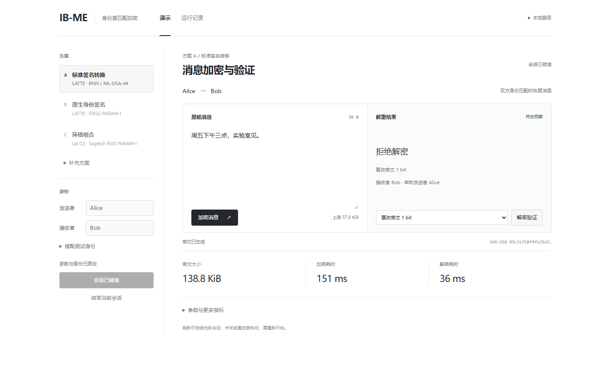

# Web 拒绝情形截图

2026-10-20，在独立的本地 `8766` 会话实际操作。原有 `8765` Falcon 会话未改动。使用与[Web 改版验收](../2026-10-20-web-redesign/README.md)相同的安装包：代码 `f9a016aebc03d12ff5df34328c8bb99870b3105e`，wheel SHA-256 `80cab56fe012dda1f881ee5f730a4dad5dbaac4df8f9eca2f2d82a53647de74d`，600 个安装文件核对通过。

交付分支随后接收 main `d770bc2`，保留 PR78 的界面修复和 PR81 的大整数精度修复。本目录继续保存上述安装版本的原始截图与导出，不改写为新版本实跑；当前主线的 Web／任务／HTTP／目录回归另测 **60 passed、0 skipped**，JavaScript 语法检查通过。

## 两张补图

| 截图 | 实际操作与结果 | 导出记录 |
|---|---|---|
| [接收者身份错配](wrong-receiver.png) | Alice 发给 Bob 的密文，用 Carol 的接收钥解密，返回 `BOTTOM`；页面显示“拒绝解密／接收者不匹配” | `observations[2]` |
| [密文篡改](tampered-ciphertext.png) | 同一密文翻转 1 bit，使用 Bob 的接收钥，返回 `BOTTOM`；页面显示“拒绝解密／篡改密文 1 bit” | `observations[3]` |

[运行记录页](records.png)和[页面按钮实际导出的 JSON](measurements.json)来自同一根、同一次加密。先完成正确身份解密，再依次运行这两个拒绝情形；三次 `expectation_met` 均为 `true`。截图为 Playwright CLI 0.1.22 的 1440×900 原始页面捕获，未修改图像或页面结果。

## 对应的实测

方案 A：LATTE-3/COSAC-FIX seed32＋BNN/ML-DSA-44＋Hybrid＋BYTEAUTH，reference 签名；完整 Suite 与[固定 A 配置](../2026-10-19-report-three-selection/suites/A-latte-mldsa44.json)逐字段一致，摘要为 `bb8006f036dfcbe3ea2d765e2cdf44a595568f4465e3b786d0b802fb4e0baf91`。LATTE N=1024、q=68718428161；载荷预算 64 KiB，应用消息容量 59191 B。参数来源与模型沿用固定配置及其原语引用，未切换教学参数；当前配置保留 `secure/true/true`。

输入为 Alice（5 B）、Bob（3 B）、Carol（5 B）与“周五下午三点，实验室见。”（36 B UTF-8）。一个新系统 CSPRNG 根、一次加密、三次解密。完整密文 142102 B；加密 0.150829 s，正常解密 0.236734 s，身份错配 0.228776 s，篡改拒绝 0.036338 s。这是操作截图的单会话记录，不计为重复性能基准。

原密文 SHA-256：`83c31f20f9fb25d353a4b3d1dda61ceb5ae9ccd5a62497b3ba34557a3b5526c8`。正常与错配解密输入该原密文；篡改输入摘要为 `e242669bfc9d0140eea25db7420199feb9236dc08b60746492ffdd002fa6d815`，原密文保持不变。

环境：i9-14900HX，WSL Linux 6.6.87.2，规定 conda Sage 10.7／Python 3.12.13，NumPy 2.4.3、cryptography 50.0.2，OMP4／OpenBLAS1。公开 JSON 不含身份文本、消息正文、私钥或密文原文；展示用身份和消息仅出现在截图及本说明。此批未改报告、Web 源码、算法或参数。

文件摘要及核对结果见 [capture-checks.json](capture-checks.json)。
